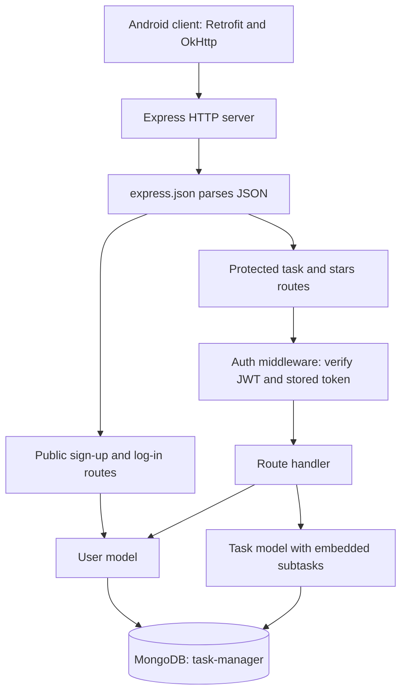
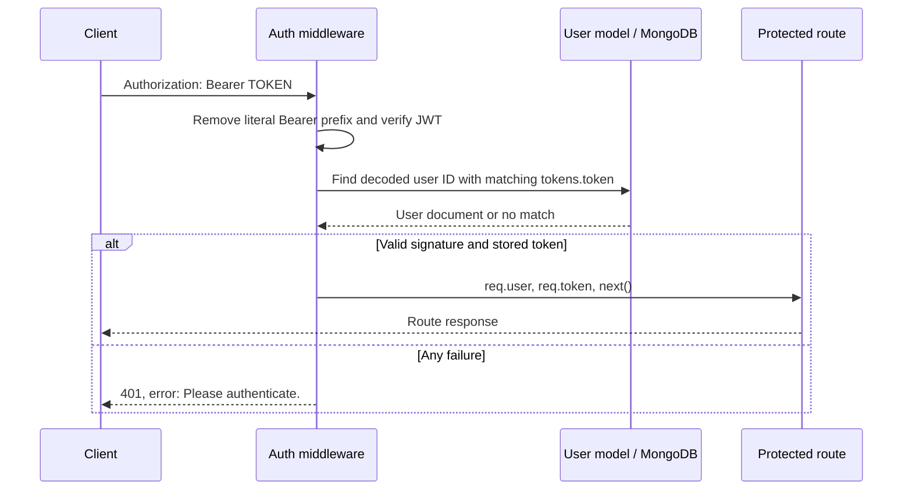
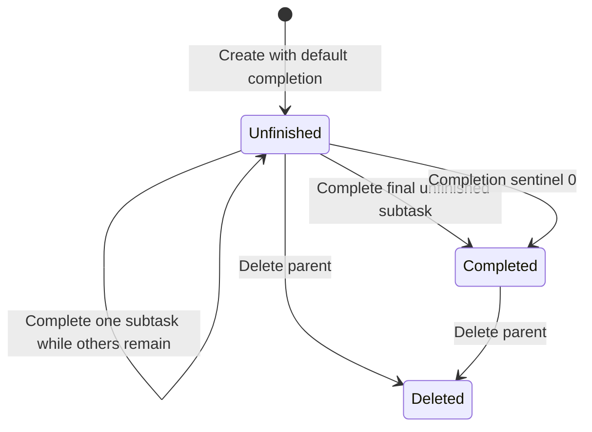

# Task Manager Backend: Detailed Code Study and Git Timeline

Prepared on **12 October 2026**, using the local repository and its available Git history. User-facing historical times below use **Asia/Calcutta / IST (UTC+05:30)**.

Analyzed revision: `1115086f1e648cf911b96bbe69adef71b4449242` (`main`, also the locally recorded `origin/main`).

This document explains the implementation that exists, including its inconsistencies. Proposed improvements are explicitly separated from implemented behavior. Git history was read locally; no remote fetch was performed. The locally recorded remote branch does not establish the current state of the GitHub server.

## Contents

1. [Scope and evidence](#1-scope-and-evidence)
2. [Git dates, upload evidence, and time range](#2-git-dates-upload-evidence-and-time-range)
3. [Architecture and backend inventory](#3-architecture-and-backend-inventory)
4. [Dependencies and configuration](#4-dependencies-and-configuration)
5. [Startup and database connection](#5-startup-and-database-connection)
6. [User model](#6-user-model)
7. [Authentication and session lifecycle](#7-authentication-and-session-lifecycle)
8. [Task model and embedded subtasks](#8-task-model-and-embedded-subtasks)
9. [Time calculations and task classification](#9-time-calculations-and-task-classification)
10. [Complete endpoint reference](#10-complete-endpoint-reference)
11. [Response contracts](#11-response-contracts)
12. [Completion, rewards, and consistency](#12-completion-rewards-and-consistency)
13. [Android integration](#13-android-integration)
14. [Security, correctness, and operational findings](#14-security-correctness-and-operational-findings)
15. [Performance and maintainability](#15-performance-and-maintainability)
16. [Local setup and manual study workflow](#16-local-setup-and-manual-study-workflow)
17. [Recommended validation matrix](#17-recommended-validation-matrix)
18. [Improvement roadmap](#18-improvement-roadmap)
19. [Learning guide and interview explanations](#19-learning-guide-and-interview-explanations)
20. [Verification and limitations](#20-verification-and-limitations)

## 1. Scope and evidence

The backend is a small Node.js service using Express, Mongoose, MongoDB, JWTs, and bcryptjs. It supports account registration, login, owner-scoped task management, embedded subtasks, deadline displays, and a star reward counter.

The study covers every tracked file in `Backend/`: seven JavaScript source files, the package manifest, and the dependency lockfile. Android files were inspected where they explain the backend's request and response contract. The Android UI is not otherwise the subject of this document.

Evidence categories used throughout:

- **Observed:** directly present in source, configuration, or Git metadata.
- **Derived:** a consequence of the code's control flow or formulas; not a claim that a live request was executed.
- **Recommended:** a proposed change, not an existing feature.
- **Unknown:** information unavailable from the repository, including actual coding hours and remote upload times.

The repository's README describes JWT authentication and task management accurately at a high level. Some details differ from the implementation: MongoDB is hardcoded rather than configured through environment variables, there is no general task-edit endpoint, and stars are awarded only by the real-subtask completion branch.

## 2. Git dates, upload evidence, and time range

### 2.1 Complete visible commit timeline

The locally available history across all refs contains four commits. Their author and committer timestamps are identical for each commit.

| Commit | Message | Author and committer time, IST | Changes relevant to this study |
|---|---|---|---|
| `ed8a330eb6609de81f9668e48facf5a99d4aeee0` | `first commit` | 6 January 2024, 14:46:13 | Adds the backend, Android source, Gradle files, and initial repository content. |
| `7e4b3774fa1628ed88d1935a2c84e8accdfdf470` | `pre commit` | 10 July 2024, 14:05:55 | Adds backend/frontend screenshots; updates README and Android/Gradle build files. No backend changes. |
| `96aa77a31041689986d3b917175178cd8ae551d5` | `pre commit` | 10 July 2024, 14:08:05 | README change only. |
| `1115086f1e648cf911b96bbe69adef71b4449242` | `final commit` | 10 July 2024, 14:08:46 | README change only. |

### 2.2 Measured ranges

| Measurement | Result | Meaning |
|---|---|---|
| Earliest visible project commit | 6 January 2024, 14:46:13 IST | Earliest recorded snapshot available locally. |
| Latest visible project commit | 10 July 2024, 14:08:46 IST | Latest recorded snapshot available locally. |
| Exact elapsed project history span | **185 days, 23 hours, 22 minutes, 33 seconds** | Difference between those timestamps. It is not time spent programming. |
| Calendar-date separation | **186 days** | Difference between the calendar dates, ignoring time of day. |
| July commit window | **2 minutes, 51 seconds** | From the first to the last commit on 10 July. |
| Backend-changing commits | **1** | Only the first commit touches `Backend/`. |
| Earliest and latest backend modification in visible history | **6 January 2024, 14:46:13 IST** | The backend arrives as one complete snapshot. |
| Backend diff from first commit to HEAD | **Empty** | All nine tracked backend files remain unchanged. |

The initial commit records **9 backend files and 2,205 inserted lines**. This includes the **1,552-line lockfile**, **21-line package manifest**, and **632 lines across seven JavaScript files**. Line counts include comments and blank lines; they are not measures of logical complexity or effort.

### 2.3 What the Git record establishes

The backend was committed by 6 January 2024 according to the recorded timestamps. Later commits add presentation material and update documentation/build configuration, rather than developing backend features. The screenshots were committed on 10 July 2024; their addition is not evidence that the backend code was written on that day.

Git cannot establish when the code was first written, how many hours were spent writing it, whether earlier uncommitted versions existed, or the exact date/time it was uploaded or pushed to GitHub. Author and committer dates are commit metadata, not hosting-server upload records, and may be set or altered. There are no incremental backend implementation commits from which to reconstruct a feature-by-feature coding schedule.

### 2.4 Reproduce the history inspection

```powershell
git log --all --reverse --date=iso-strict --format="%H|%aI|%cI|%s"
git log --all --date=iso-strict --format="%H|%aI|%s" --stat -- Backend
git diff ed8a330eb6609de81f9668e48facf5a99d4aeee0 HEAD -- Backend
git ls-files Backend
```

`%aI` is the author timestamp; `%cI` is the committer timestamp. The empty backend diff is stronger evidence of unchanged content than the commit messages alone.

## 3. Architecture and backend inventory

### 3.1 Request architecture



The service uses CommonJS modules (`require` and `module.exports`). Routes contain request handling, validation, persistence, business rules, and response construction directly. There are no separate controllers, service layer, repository abstraction, background workers, or scheduler in the backend.

### 3.2 Directory structure

```text
Backend/
├── package.json
├── package-lock.json
└── src/
    ├── app.js
    ├── db/
    │   └── mongoose.js
    ├── middleware/
    │   └── auth.js
    ├── model/
    │   ├── user.js
    │   └── task.js
    └── routes/
        ├── user.js
        └── task.js
```

### 3.3 File responsibility map

| File | Lines | Responsibility |
|---|---:|---|
| [`Backend/src/app.js`](Backend/src/app.js) | 17 | Starts the connection import, JSON middleware, routers, and HTTP listener. |
| [`Backend/src/db/mongoose.js`](Backend/src/db/mongoose.js) | 6 | Connects Mongoose to the local MongoDB database. |
| [`Backend/src/middleware/auth.js`](Backend/src/middleware/auth.js) | 25 | Validates JWT and token membership; attaches authenticated user/token. |
| [`Backend/src/model/user.js`](Backend/src/model/user.js) | 96 | User schema, password hashing, credential checking, token generation, and safe serialization. |
| [`Backend/src/model/task.js`](Backend/src/model/task.js) | 92 | Task/subtask schema and five calculated virtual properties. |
| [`Backend/src/routes/user.js`](Backend/src/routes/user.js) | 42 | Registration, login, and stars. |
| [`Backend/src/routes/task.js`](Backend/src/routes/task.js) | 354 | Task creation/list/detail/deletion, subtask insertion/deletion, completion, and rewards. |

The task router represents more than half the backend source lines. It is the main business-logic concentration and the best starting point for studying task behavior.

## 4. Dependencies and configuration

### 4.1 Declared and locked versions

These are repository versions, not claims about the latest releases or their present security status.

| Package | Manifest range | Version recorded in lockfile | Usage |
|---|---|---|---|
| `express` | `^4.18.2` | `4.18.2` | HTTP app, routers, JSON parsing, responses. |
| `mongoose` | `^8.0.3` | `8.0.3` | Schemas, documents, queries, hooks, virtuals, MongoDB connection. |
| `jsonwebtoken` | `^9.0.2` | `9.0.2` | JWT signing and verification. |
| `bcryptjs` | `^2.4.3` | `2.4.3` | Password hashing and comparison. |
| `validator` | `^13.11.0` | `13.11.0` | Email-format validation. |
| `nodemon` | `^3.0.2` | `3.0.2` | Restart-on-change development command. |
| `punycode.js` | `^2.3.1` | `2.3.1` | Declared directly, but not imported by any backend source file. |

The lockfile is format version **3**. `npm ci` is appropriate for installing the recorded dependency graph when a compatible Node/npm environment exists. Regenerating or updating dependencies is separate work.

The locked Mongoose package declares Node `>=16.20.1`; the project itself does not declare `engines`, an `.nvmrc`, or a runtime version. That dependency minimum is historical compatibility metadata, not a recommendation to deploy an old runtime today.

### 4.2 Package scripts and metadata

```json
{
  "start": "node src/app.js",
  "dev": "nodemon src/app.js"
}
```

Package name: `task_manager`; version: `1.0.0`; license field: `ISC`. Description and author are empty. `main` says `app.js`, although the actual entry used by the scripts is `src/app.js`. The scripts work independently of that metadata mismatch; importing the package through its `main` would point at a nonexistent root entry.

There is no backend test, lint, type-check, or build script. `nodemon` is under production `dependencies`, not `devDependencies`.

### 4.3 Actual configuration surface

| Setting | Actual implementation |
|---|---|
| HTTP port | `process.env.PORT || 3000`. |
| MongoDB URI | Literal `mongodb://localhost:27017/task-manager`. |
| JWT signing/verification secret | Same hardcoded string in user model and auth middleware. |
| JWT expiry | No `expiresIn` supplied. |
| Bcrypt work factor | Literal `8`. |
| API prefix | None; endpoints are mounted at the server root. |
| Time zone | No explicit backend time-zone setting. |
| JSON parsing | `express.json()` without custom options. |

Only `PORT` is read from the environment. Setting a `MONGODB_URI` or `JWT_SECRET` variable does not change this implementation without a code change.

## 5. Startup and database connection

Source: `Backend/src/app.js:1–17` and `Backend/src/db/mongoose.js:1–6`.

The startup sequence is:

1. Load Express.
2. Require the database module, which starts an asynchronous `mongoose.connect()` call.
3. Load the task and user routers, which load their models and middleware.
4. Resolve the HTTP port.
5. Create an Express application and register JSON parsing.
6. Mount the user router, then the task router.
7. Call `app.listen()`.

Database connection completion is not awaited before opening the HTTP listener. The process can print `Server listening on port ...` before `MongoDB connected`. A connection rejection is logged by the database module, but startup is not explicitly failed and the HTTP listener is not explicitly closed. Consequently, accepting TCP/HTTP traffic does not prove that persistence is ready.

There is no health endpoint, readiness endpoint, shutdown handler, custom unknown-route handler, or centralized error middleware in application code. Express can still provide its default behavior for unmatched routes and parser errors; that behavior is outside the custom JSON contracts documented below.

The app is not exported independently of the listener. Importing `app.js` starts side effects, which makes isolated integration tests harder. A recommended structure is an exported app factory plus a separate executable startup module that awaits database readiness.

## 6. User model

Source: `Backend/src/model/user.js`.

### 6.1 Stored fields

| Field | Type | Required/default | Transform or validation |
|---|---|---|---|
| `_id` | ObjectId | Generated | Primary document identifier. |
| `name` | String | Required | Trimmed. |
| `email` | String | Required; unique index declaration | Lowercased, trimmed, checked with `validator.isEmail`. |
| `password` | String | Required; minimum length 8 | Trimmed; hashed before save when modified. |
| `star` | Number | Default `0` | No minimum, maximum, or integer-only validator. |
| `tokens` | Embedded array | No custom default declared | Each entry has a required String `token`. |
| `__v` | Version key | Framework-managed | Not removed by the custom serializer. |

No user creation/update timestamps are declared. Email uniqueness is an index declaration, not the custom email validator; duplicate registration can fail at the database/index layer, and the route hides the distinction behind its generic error response. Index creation/readiness was not verified against a database.

### 6.2 Relationship to tasks

```javascript
userSchema.virtual("tasks", {
  ref: "Task",
  localField: "_id",
  foreignField: "owner"
});
```

The relationship is resolved by comparing a user's `_id` with task `owner`. A task-ID array is not stored on the user. `GET /task` calls `req.user.populate("tasks")`, obtaining matching task documents through this virtual relationship.

`ref: "User"` and `ref: "Task"` describe model relationships. The source does not implement a database-enforced foreign key or cascading account deletion.

### 6.3 Password save hook

At line 87, a `pre("save")` hook checks `user.isModified("password")`. If true, it replaces the password with `await bcrypt.hash(user.password, 8)`, then calls `next()`.

This allows the initial plaintext password to be transformed before persistence and avoids rehashing the existing hash when the same user is saved for tokens or stars. The bcrypt hash is one-way; login compares a candidate rather than decrypting the stored value.

Registration trims the stored password because of the schema setter. Credential comparison uses the supplied login password directly. Leading/trailing whitespace therefore deserves an explicit test and a documented product policy rather than an assumption of exact raw-string preservation.

### 6.4 Credential method

`User.findByCredentials(email, password)` is a **model static**:

1. Find one user by email.
2. Throw an error if no user exists.
3. Compare supplied password with the stored bcrypt hash.
4. Throw an error if comparison fails.
5. Return the user document otherwise.

The route does not explicitly normalize login email; it forwards it to this query. Because the schema has lowercase/trim setters, do not assume query casing behavior solely from the route. Verify mixed-case and whitespace input with the installed Mongoose version.

### 6.5 Token method

`user.generateAuthToken()` is a **document instance method**:

1. Sign a JWT whose `_id` is `user._id.toString()`.
2. Append `{ token }` to the stored token array.
3. Save the user.
4. Return the token.

There is no explicit random token identifier, token limit, expiration, or refresh-token mechanism. Repeated generation for the same user within the same JWT timestamp interval can produce identical tokens because the payload and signing configuration are otherwise identical; the source does not prevent duplicate token-array entries.

### 6.6 JSON serialization

The custom `toJSON()` calls `toObject()`, removes `password` and `tokens`, and returns the remaining object. This protects those two fields when a user document is serialized as JSON. It does not prevent them from being read by server code, printed in arbitrary logs, or returned through another manually constructed object.

Current registration/login responses return `{ message, token }`, not the user document, so this serializer is mostly a reusable model safeguard in the present routes.

### 6.7 Unrestricted registration fields

Registration passes `req.body` directly into `new User(...)`. There is no allowlist restricting clients to `name`, `email`, and `password`. Schema-defined server-managed fields, particularly `star` and `tokens`, can therefore be supplied by a caller and accepted if they satisfy the schema. Unknown fields are a separate issue; schema strictness does not protect known sensitive fields.

Recommended registration input: explicitly copy only `name`, `email`, and `password`; initialize reward/session state exclusively on the server.

## 7. Authentication and session lifecycle

Source: `Backend/src/middleware/auth.js:4–23`.

### 7.1 Authentication algorithm



Both checks matter: a correctly signed JWT must also exist in the corresponding user's stored token array. This provides a foundation for revocation through removing stored tokens, but there is no logout/revocation endpoint implementing that operation.

### 7.2 Header handling

The middleware obtains `req.header("Authorization")` and calls `.replace("Bearer ", "")`. It does not explicitly validate the authentication scheme or require a prefix before verification.

- Missing header causes an exception when `.replace` is called; the catch returns 401.
- Invalid or unverifiable JWT returns 401.
- Valid JWT absent from the user's tokens returns 401.
- A raw valid JWT without `Bearer ` can reach verification because replace leaves it unchanged.
- Database lookup errors also fall into the same 401 catch.

The final point conflates infrastructure failure with invalid credentials. A client may be prompted to log in again even though its token is valid and the database is unavailable.

### 7.3 Session behavior

Tokens are issued during both registration and login. Authentication performs a database read on every protected request. Stored tokens remain until changed outside the available routes. There is no automatic expiry configured by the signing call, no logout, no logout-all, no refresh endpoint, and no password reset/change route.

The JWT is signed, not encrypted. Its user identifier should not be treated as secret merely because it is inside a token. The token itself is a bearer credential and should not be printed or committed.

## 8. Task model and embedded subtasks

Source: `Backend/src/model/task.js:1–26`.

### 8.1 Task fields

| Field | Type | Required/default | Meaning and current constraints |
|---|---|---|---|
| `_id` | ObjectId | Generated | Task identifier. |
| `title` | String | Required | No explicit trim or length limit. |
| `description` | String | Optional | No default or length limit. |
| `createdAt` | Date | Default `Date.now` | Application creation time; caller can supply a value. |
| `endTime` | Date | Required | Main deadline; no schema-level future-date rule. |
| `subtasks` | Embedded array | Array schema | Subtasks live inside the task document. |
| `priority` | String | Optional | Enum: `high`, `medium`, `low`; no default. |
| `completed` | Boolean | Default `false` | Main completion flag. |
| `completedDate` | Date | Optional | Assigned by completion paths, but also accepted from create input. |
| `owner` | ObjectId | Required; ref `User` | Server overwrites creation input with authenticated user ID. |
| `__v` | Version key | Framework-managed | Not exposed by the manual top-level task DTO. |

There is a manual `createdAt` field, but no schema `{ timestamps: true }` option and no `updatedAt`. Priority is available to clients but does not affect server filtering, ordering, deadlines, or rewards.

### 8.2 Subtask fields

| Field | Type | Required/default | Current behavior |
|---|---|---|---|
| `_id` | ObjectId | Generated embedded ID | Used for deletion and completion. |
| `name` | String | Required | No explicit trim/length limit. |
| `description` | String | Optional | Free-form text. |
| `startTime` | Date | Optional in schema | Creation/insertion routes replace it with current server time. |
| `endTime` | Date | Required | Subtask deadline. |
| `completed` | Boolean | Default `false` | Caller can supply it during creation/insertion. |
| `completedDate` | Date | Optional | Set by completion; also accepted from input. |

Subtasks have no separate collection or owner field. Ownership is inherited from their parent task; the router first finds a task owned by the requester, then works with that task's subtask array.

### 8.3 Embedded-document tradeoffs

Embedding simplifies loading a task with its checklist and allows a single task save to persist subtask changes. It also means every populated task includes its whole subtask array, array size is not capped by application validation, and whole-document read/modify/save paths need deliberate concurrency handling.

The schema does not enforce consistency between parent and subtask completion, prevent completing a subtask before `startTime`, or relate `completedDate` to `completed`. Those are potential business invariants, not existing database guarantees.

## 9. Time calculations and task classification

### 9.1 Sources of time

| Time value | Origin |
|---|---|
| Task `createdAt` | Model default `Date.now`, unless provided by caller. |
| Initial subtask `startTime` | One shared `new Date()` captured in the create route. |
| Added subtask `startTime` | `new Date()` at insertion. |
| Deadline | Client input converted to Date by Mongoose / JavaScript comparisons. |
| Completion timestamp | `new Date()` in completion route. |
| Current time for list/detail classification | One `new Date()` per handler. |
| Current time for each countdown virtual | A fresh `new Date()` per virtual access. |

No scheduler changes task state at a deadline. Overdue status is derived during reads; the stored `completed` field is changed only by request handling or caller-provided input. Countdown values are snapshots, not pushed updates.

### 9.2 Classification rules

For one handler's captured `now`:

```text
pending     = completed === false AND endTime < now
inProgress  = completed === false AND endTime > now
completed   = completed is true
```

Here `pending` means **overdue and unfinished**, rather than all unfinished work. Exactly equal deadlines belong to neither unfinished category because both comparisons are strict. In list results, such a task can appear in neither list at that instant. In detail, it reaches the final 400 response if neither other branch applies.

The main task deadline controls classification. An overdue subtask does not make a parent overdue when the parent's deadline is still in the future.

### 9.3 Subtask ordering and selection

Creation and subtask insertion sort subtasks ascending by `endTime`. The virtuals then use the **first incomplete subtask in array order**. Under those route-maintained ordering rules, it is the earliest unfinished deadline.

The virtual itself does not sort or query the minimum deadline. External database edits or future routes that fail to preserve order can change the meaning of “next.” An overdue incomplete subtask remains first; the calculation does not skip it to find a future subtask.

### 9.4 `daysLeft`

Source: `task.js:28–42`.

```text
target = first incomplete subtask.endTime, if one exists
         otherwise task.endTime
remainingMs = max(0, target - now)
daysLeft = floor(remainingMs / 86,400,000)
```

This counts complete 24-hour periods, not calendar-day boundaries and not rounded-up days. A deadline 23 hours away gives `0`; one 25 hours away gives `1`; a past deadline gives `0`. The clamp hides how overdue the target is.

### 9.5 `nextSubtask`

Source: `task.js:44–52`.

Return the embedded `_id` of the first subtask whose `completed` value is falsy; return `null` when there is none. This virtual does not check main-task completion or whether the subtask deadline is past. Routes selectively replace it with `null` in completed responses.

### 9.6 Progress counts

Source: `task.js:54–65`.

```text
completedSubtasksCount = number of completed subtasks, when subtasks exist
                         otherwise 1 if task completed, else 0
totalSubtasksCount = subtasks.length, when subtasks exist
                    otherwise 1
```

A task without subtasks is represented as one progress unit. This lets a client calculate a ratio without a zero denominator:

```text
progress = completedSubtasksCount / totalSubtasksCount
```

With subtasks, progress derives from subtask flags even when the parent flag is inconsistent. Force-completing a task can therefore produce `completed: true` alongside incomplete progress.

### 9.7 `timeRemaining`

Source: `task.js:67–87`.

The target selection matches `daysLeft`. The remaining duration is clamped to zero, then formatted as:

```text
hours = floor(remainingMs / 3,600,000)
minutes = floor((remainingMs modulo 3,600,000) / 60,000)
"{hours} hrs {minutes} mins"
```

Hours are total hours, not hours after extracting days. A duration of 49 hours 10 minutes displays `49 hrs 10 mins`; seconds are discarded. Accessing `daysLeft` and `timeRemaining` separately obtains slightly different current times, so a boundary crossing can produce small inconsistencies.

### 9.8 Concrete time examples

For these examples only, assume a frozen clock of **12 October 2026, 10:00 IST**, equivalent to `2026-10-12T04:30:00.000Z`. Examples are formula illustrations, not executed tests.

| Task/subtask situation | Classification | Countdown target | `daysLeft` | `timeRemaining` |
|---|---|---|---:|---|
| No subtasks; unfinished parent due 13 October at 09:00 IST | `inProgress` | Parent deadline | 0 | `23 hrs 0 mins` |
| No subtasks; unfinished parent due 13 October at 11:00 IST | `inProgress` | Parent deadline | 1 | `25 hrs 0 mins` |
| Parent due in 3 days; first incomplete subtask due in 90 minutes | `inProgress` | Subtask deadline | 0 | `1 hrs 30 mins` |
| Parent due tomorrow; first incomplete subtask expired yesterday | `inProgress` | Expired subtask | 0 | `0 hrs 0 mins` |
| Unfinished parent expired yesterday | `pending` | Route forces zeros | 0 | `0 hrs 0 mins` |
| Completed parent with future deadline | `completed` | Route forces zeros | 0 | `0 hrs 0 mins` |

### 9.9 Time-zone contract

The Android creation and subtask screens construct `endTime` using `"${date}T${time}"`, without appending an explicit UTC marker or offset at those construction sites. The backend has no explicit time-zone policy, so interpretation of offset-free date/time strings depends on parsing and the server environment.

Recommended API input: explicit ISO 8601 instants such as `2026-10-12T18:00:00+05:30` or `2026-10-12T12:30:00.000Z`. Render them in the user's local zone in the app. Do not infer a server's zone from the developer's location.

## 10. Complete endpoint reference

There are **10 endpoints**: 3 user endpoints and 7 task endpoints. Eight require auth; registration and login are public. All paths are relative to the HTTP server root.

| Method | Path | Auth | Typical success |
|---|---|---|---|
| POST | `/sign-up` | No | 201, message and token. |
| POST | `/log-in` | No | 200, message and token. |
| GET | `/stars` | Yes | 200, string-valued star. |
| POST | `/task` | Yes | 201, creation message. |
| POST | `/task/:id/sub-task` | Yes | 201, insertion message. |
| GET | `/task?status=...` | Yes | 200, `{ tasks: [...] }`. |
| GET | `/task/:id` | Yes | 200, single task DTO. |
| DELETE | `/task/:id` | Yes | 201, deletion message. |
| DELETE | `/task/:taskId/sub-task/:subtaskId` | Yes | 201, deletion message. |
| PATCH | `/complete/task/:id/sub-task/:subTaskId` | Yes | 202, JSON message or empty body depending on branch. |

Every protected endpoint can first return `401 { "error": "Please authenticate." }`. The error cases below describe behavior after authentication succeeds.

### 10.1 Registration: `POST /sign-up`

Source: `routes/user.js:6–16`.

Typical request:

```json
{
  "name": "Study User",
  "email": "study@example.com",
  "password": "ExamplePass123!"
}
```

Processing: construct user from the entire body; save it (validation and password hook run); generate token (another user save); send success.

Success: `201 { "message": "Success", "token": "<JWT>" }`.

Caught failure: `400 { "message": "Error", "token": "" }`. Validation, duplicate email, token-generation errors, and database problems are flattened into that response.

The user is first constructed outside the route's `try` block. Moving all construction and validation into controlled error handling would make the route more consistent, especially for unexpected synchronous construction failures in an async Express 4 handler.

The two saves are not a transaction. If the first succeeds and token generation/save fails, the response can say registration failed even though the account exists. A retry may then encounter duplicate email.

### 10.2 Login: `POST /log-in`

Source: `routes/user.js:18–29`.

Request: `{ "email": "study@example.com", "password": "ExamplePass123!" }`.

The route uses `User.findByCredentials`, generates/appends a token, and returns `200 { "message": "Success", "token": "<JWT>" }`. It returns the same 400 error/token-empty body as registration on caught failure. There is no rate limiter, failed-attempt counter, or lockout behavior in source.

### 10.3 Stars: `GET /stars`

Source: `routes/user.js:31–39`.

The handler converts the already-loaded numeric `req.user.star` to a string with `+ ""` and returns `200 { "star": "0" }` (or another count). It does not calculate rewards from tasks. Caught errors return `500` with the caught value passed to `send`; the route supplies no consistent message envelope for that failure.

### 10.4 Create task: `POST /task`

Source: `routes/task.js:8–51`.

Illustrative request; choose future deadlines when actually exercising the endpoint:

```json
{
  "title": "Study the backend",
  "description": "Read models, routes, and auth",
  "endTime": "2099-01-10T18:00:00+05:30",
  "priority": "high",
  "subtasks": [
    {
      "name": "Read the user model",
      "description": "Trace password hashing and tokens",
      "endTime": "2099-01-09T18:00:00+05:30"
    }
  ]
}
```

Processing:

1. Use `req.body` as `taskData`.
2. If subtasks are present/nonempty, set every `startTime` to the same current server instant.
3. Sort them ascending by deadline.
4. Construct `new Task({ ...taskData, owner: req.user._id })`; the last property overrides a caller-supplied owner.
5. If the final sorted subtask deadline exceeds the supplied parent deadline, extend the parent deadline to it.
6. Check whether the resulting parent deadline is before now.
7. Save and return the success message.

Success: `201 { "message": "Task Created" }`; caught failure: `500 { "message": "Error creating task" }`.

**Control-flow defect:** step 6 sends the 500 response but does not return. The code proceeds to save the task and then attempts a 201 response. Because the schema has no future-date validator, an otherwise valid past task can be persisted after the caller received an error. Later response attempts can encounter headers-already-sent errors; the catch also attempts a response. This is a derived defect from the source, not a reproduced live incident.

Initial subtasks are not individually checked for past deadlines. A valid future parent can contain overdue initial subtasks. Creation can extend the parent to fit a subtask, while insertion into an existing parent rejects the same deadline relationship.

The route does not allowlist task/subtask fields. Besides legitimate fields, a caller can supply schema-defined `completed`, `completedDate`, `createdAt`, and subtask completion flags. Owner override is a good safeguard but does not protect these other server-managed fields.

### 10.5 Add subtask: `POST /task/:id/sub-task`

Source: `routes/task.js:55–98`.

Typical body: `{ "name": "Review routes", "description": "Map errors", "endTime": "2099-01-09T18:00:00+05:30" }`.

The route finds the parent using both ID and authenticated owner. A missing or another user's task returns `404 { "message": "Task not found" }`. It sets the new subtask's start time, then rejects:

- Deadline after parent deadline: `400 { "message": "Subtask end time cannot exceed main task's end time" }`.
- Deadline before the current instant: `400 { "message": "Subtask end time cannot be in the past" }`.

Equality with the parent deadline is allowed. Invalid date input can evade comparison checks because invalid dates do not compare normally; persistence validation then provides the later failure path.

The route appends, re-sorts the full array, and saves. Success: `201 { "message": "SubTask Successfully Added" }`. Caught failure: `500` with **plain text** `Error creating subtask`.

There is no check that the parent is unfinished. A completed parent can receive a new unfinished subtask while retaining `completed: true`, and later completion requests are blocked by the completed-parent check.

### 10.6 List tasks: `GET /task?status=...`

Source: `routes/task.js:101–177`.

Allowed values are exact, case-sensitive strings: `pending`, `inProgress`, and `completed`. Missing or unrecognized status gives `400 { "message": "Invalid status parameter" }`.

The handler populates all tasks for the user **before** selecting a category. It filters in JavaScript and manually maps documents to DTOs. Success: `200 { "tasks": [...] }`; no matches means an empty array. Caught failure: `500 { "message": "Error fetching tasks" }`.

For overdue tasks, list DTOs force `nextSubtask: null`, zero countdowns, and `completedDate: "0"`. In-progress DTOs use countdown/next-subtask virtuals and the same completion-date sentinel. Completed DTOs use the stored completion date and force null/zero countdowns.

There is no pagination, title search, explicit parent-task sorting, priority filter, or limit. Array order should not be treated as a documented priority/deadline order.

### 10.7 Single task: `GET /task/:id`

Source: `routes/task.js:180–246`.

The lookup uses task ID and owner, then classifies and returns a **bare task DTO**, without `{ tasks: ... }` or `{ task: ... }` wrapping. Caught failure: `500 { "message": "Error fetching tasks" }`.

There is no null check before `task.endTime` is accessed. A well-formed nonexistent ID or another user's task therefore results in an exception and 500 rather than a controlled 404. Malformed IDs can also fail in the query path.

For an overdue unfinished parent, this endpoint exposes `task.nextSubtask`; the list endpoint forces the same field to `null`. This inconsistency can make list and detail screens disagree about whether a next subtask exists.

### 10.8 Delete task: `DELETE /task/:id`

Source: `routes/task.js:250–260`.

Find by ID and owner; invoke `task.deleteOne()`; return `201 { "message": "SucessFully Removed" }` (spelling preserved). Embedded subtasks are removed as part of deleting the parent document.

No null guard exists before `deleteOne()`, so missing/other-owner tasks fall into `500 { "message": "Error" }`. Star totals are not adjusted. The use of 201 for deletion is the actual contract, although a future API would normally use 200 with JSON or 204 without a body.

### 10.9 Delete subtask: `DELETE /task/:taskId/sub-task/:subtaskId`

Source: `routes/task.js:263–291`.

Find the owned parent; return 404 if absent. Find the subtask index with `_id.equals(subtaskId)`; return `404 { "message": "Subtask not found" }` if no match. Remove with `splice`, save, and return `201 { "message": "Successfully removed subtask" }`.

Caught failure: `500 { "message": "Error deleting subtask" }`.

Deletion does not shrink the main deadline, recalculate main completion, update parent completion time, or subtract earned stars. Deleting the last unfinished subtask can leave a parent unfinished even when all remaining subtasks are completed. Deleting all subtasks switches progress calculations to the single-unit parent fallback.

### 10.10 Complete task/subtask: `PATCH /complete/task/:id/sub-task/:subTaskId`

Source: `routes/task.js:295–352`.

No request body is needed. The path itself selects the completion operation.

Initial checks:

- Missing/other-owner parent: `400 { "message": "Task not found" }`.
- Already-completed parent: `404 { "message": "Task Already Completed" }`.

**Sentinel branch, `subTaskId === "0"`:** mark parent completed, set parent completion time, save, return **202 with an empty body**. It does not require the subtask array to be empty, does not complete existing subtasks, and does not award a star.

**Real subtask branch:** find embedded subtask by ID. Missing subtask gives `404 { "message": "Subtask not found" }`; already-completed subtask gives `404 { "message": "Task Already Completed" }`. Otherwise:

1. Set subtask `completed = true` and its completion time.
2. Count all completed subtasks.
3. Set parent `completed` according to whether that count equals array length.
4. If all are completed, set parent completion time.
5. Increment `req.user.star` by one.
6. Save the user.
7. Save the task.
8. Return `202 { "message": "SuccessFully Done" }`.

Caught failure: `500 { "message": "Error completing task/subtask" }`.

There is no deadline check: overdue subtasks can be completed and rewarded. There is no enforced next-subtask ordering: a caller can complete any available unfinished subtask by ID. There is no undo/reopen endpoint. The 202 responses occur after awaited persistence, rather than queuing a background job.

## 11. Response contracts

### 11.1 Task DTO

The routers manually build task objects. The persisted field `subtasks` is returned as singular **`subtask`**; persisted `_id` becomes top-level **`id`**. Embedded subtasks retain `_id`.

Illustrative in-progress DTO:

```json
{
  "id": "<task ObjectId>",
  "title": "Study the backend",
  "description": "Read all source files",
  "endTime": "2026-10-15T04:30:00.000Z",
  "priority": "high",
  "completed": false,
  "createdAt": "2026-10-12T04:30:00.000Z",
  "completedDate": "0",
  "subtask": [
    {
      "_id": "<subtask ObjectId>",
      "name": "Read authentication",
      "description": "Trace middleware",
      "startTime": "2026-10-12T04:30:00.000Z",
      "endTime": "2026-10-12T06:00:00.000Z",
      "completed": false
    }
  ],
  "nextSubtask": "<subtask ObjectId>",
  "daysLeft": 0,
  "timeRemaining": "1 hrs 30 mins",
  "completedSubtasksCount": 0,
  "totalSubtasksCount": 1
}
```

Countdowns assume the frozen clock used in Section 9. This is an example shape, not a captured server response.

### 11.2 Field semantics and variability

| Field | Output meaning |
|---|---|
| `id` | Task identifier, serialized from ObjectId. |
| `title` | Stored title. |
| `description` | Stored optional description; can be omitted if undefined. |
| `endTime` | Date serialized as an instant string. |
| `priority` | Stored optional enum; can be omitted if undefined. |
| `completed` | Main stored completion flag. |
| `createdAt` | Stored creation time. |
| `completedDate` | Literal string `"0"` for unfinished tasks; stored date for completed tasks, potentially absent if inconsistent input never supplied it. |
| `subtask` | Full embedded subtask array. |
| `nextSubtask` | Embedded ID or null, with branch differences described below. |
| `daysLeft` | Computed whole days, or route-forced zero. |
| `timeRemaining` | Computed human-readable duration, or route-forced zero string. |
| `completedSubtasksCount` | Virtual count/fallback. |
| `totalSubtasksCount` | Virtual count/fallback. |

The DTO omits owner, top-level `_id`, and top-level version key. Five virtual values are explicitly read and inserted, rather than depending on automatic virtual serialization.

### 11.3 Branch differences

| State | List `nextSubtask` | Detail `nextSubtask` | Countdown | Completion date |
|---|---|---|---|---|
| Overdue unfinished | `null` | First incomplete ID or null | Forced zero | `"0"` |
| Future unfinished | Virtual result | Virtual result | Virtual values | `"0"` |
| Completed | `null` | `null` | Forced zero | Stored date |

### 11.4 Contract cleanup proposal

Use a shared DTO mapper to prevent divergence. Prefer `completedDate: null` for no completion date, numeric `star`, a stable subtask naming convention, and consistent JSON error envelopes. Any change must be coordinated with Android models and message handling; it is not a backend-only rename.

## 12. Completion, rewards, and consistency

### 12.1 State transition model



Overdue is a derived time condition inside `Unfinished`, not a stored state. The state diagram assumes ordinary default creation; unrestricted input can create documents outside this expected sequence.

### 12.2 Actual reward policy

| Operation | Star change |
|---|---:|
| Complete one real unfinished subtask successfully | +1 |
| Complete final real subtask and consequently complete parent | +1 total for this operation |
| Complete parent using sentinel `0` | 0 |
| Create task/subtask already marked completed through accepted input | 0 |
| Delete completed task/subtask | 0 |
| Add subtask | 0 |

The counter measures rewarded completion operations, not the number of currently completed tasks. It can differ from the current task dataset because deletions do not reverse stars and registration accepts a caller-supplied starting counter.

### 12.3 Partial-write failure

User save precedes task save:

```text
load user/task
mark subtask complete in memory
increase stars in memory
save user   ← reward may now be durable
save task   ← failure here leaves reward without durable completion
```

A retry can reward the same still-unfinished stored subtask again. There is no transaction to make the two document writes succeed or fail together.

### 12.4 Concurrent requests

The route reads mutable documents and later saves them. Two requests can both observe an unfinished subtask or the same old star value before either save completes. Outcomes depend on timing and persistence/version behavior: reward increments may be lost, an operation may encounter a save conflict, or task/user changes may become inconsistent.

Do not assume default document saving provides application-level idempotency or cross-document atomicity. The code does not explicitly enable optimistic concurrency, use a conditional completion update, perform an atomic `$inc`, or use a transaction.

Recommended design: define a completion transition that is conditional on previously unfinished state, combine task/reward updates in a transaction when the database deployment supports it, and make retries return a stable result without another reward. A transaction alone still needs an intentional retry/idempotency policy.

### 12.5 Parent/subtask invariants currently missing

Potential invariants to define before modifying code:

1. Can a parent be completed while subtasks remain unfinished?
2. Can subtasks be added to a completed parent?
3. Should deleting the last unfinished subtask complete the parent?
4. Does completing a parent without subtasks earn a star?
5. Should overdue completion earn the same reward?
6. Are stars historical achievements or a count derived from current data?

Current behavior answers these inconsistently across routes. The source does not establish the intended product policy; recommendations should not silently invent it.

## 13. Android integration

### 13.1 API definitions

Source: `app/src/main/java/com/example/task_manger/data/remote/`.

`UserApi.kt` declares registration and login. `TaskManagerApi.kt` declares all eight protected calls, including stars. Together they match all ten backend endpoints. Task listing expects a wrapper `TaskResponse`, while single-task retrieval expects the bare `Task` model.

### 13.2 Headers and tokens

`UserHeaderInterceptor` adds `Content-Type: application/json`. `TaskHeaderInterceptor` reads a token from `LocalUserManager`, then adds both the JSON header and `Authorization: Bearer <token>`.

The task interceptor caches the first nonempty token in an instance field. `AppModule` provides the interceptor as a singleton. A later token change in DataStore is not automatically reread once that field is populated, which can matter when a user switches accounts or obtains a replacement token within the same process.

The backend uses the token's user identity, not a request-body user ID, to scope protected actions. A stale client token therefore means requests can remain associated with the old identity until the cached value changes or the interceptor is recreated.

### 13.3 Base URL

`utils/Constants.kt` contains `http://Ip-Address:3000/`. This is a placeholder. To run the app, replace it with an address reachable from the chosen emulator/device. The URI for the app and MongoDB URI solve different problems: the app connects to Express; Express connects to MongoDB.

### 13.4 Model compatibility

- `UserStars.star` is a String, matching `/stars`.
- `Task.completedDate` is a String, matching the unfinished sentinel and serialized dates.
- `Task.nextSubtask` is nullable.
- `Task.subtask` uses the backend's singular response name, while `InputTask.subtasks` uses the plural input name.
- `Task.description` and `Task.priority` are nonnullable Kotlin Strings, although the backend allows them to be omitted. This is a contract risk; deserializer/runtime effects need an Android integration test.
- Subtask fields are mostly nullable in the Android model, accommodating omitted optional backend data.

### 13.5 Empty completion response

Android's `postTaskComplete` returns a nonnullable `Message`, whose required field is `message`. The backend sentinel branch sends an empty 202 body. This is a direct contract mismatch.

Depending on Retrofit conversion and runtime handling, the app can see conversion/null-handling failures or report a generic error after the backend has already completed the task. `TaskRepoImp` catches exceptions around this call and substitutes `Message("Some Thing Went Wrong")`, so a server-side success can be obscured. Returning a JSON `Message` consistently, or making the client explicitly handle an empty response, would resolve the mismatch.

### 13.6 Error propagation

Several mutation repository methods replace exceptions with generic messages such as `Error` or `Some Thing Went Wrong`. This hides specific backend 400/404 validation details from the caller. For list/detail, the outer `try` surrounds construction of a cold `flow`, while the network request runs inside the flow during collection; that outer catch does not handle a later collection-time network failure. Consumers must handle flow errors deliberately.

### 13.7 Input date and priority transformation

`CreateTaskScreen.kt` lowercases the selected priority before creating `InputTask`. This aligns ordinary UI input with the lowercase backend enum. Creation and subtask insertion construct an offset-free date/time string; an explicit time-zone conversion should become part of the contract, as explained in Section 9.

## 14. Security, correctness, and operational findings

Severity here is an engineering triage assessment based on source inspection, not a penetration-test or dependency vulnerability rating.

| Priority | Finding | Evidence | Practical consequence | Recommended action |
|---|---|---|---|---|
| High | Hardcoded JWT secret | `model/user.js:67`, `middleware/auth.js:8` | Source-distributed deployments share a known signing value; stored-token checking is an additional defense but does not make the secret appropriate. | Use deployment secrets; plan rotation and session invalidation. |
| High | Registration accepts server-managed fields | `routes/user.js:7` | A caller can set initial reward/session fields allowed by the schema. | Allowlist registration properties. |
| High | Past-deadline error does not stop creation | `routes/task.js:42–46` | Failed HTTP result can still create a task; subsequent sends fail. | Return before persistence; validate dates before constructing/saving. |
| High | Reward/task writes are separate | `routes/task.js:343–345` | Reward can persist when completion fails; retries can reward again. | Conditional transition plus transactional/atomic consistency design. |
| Medium | Task/subtask create accepts completion state | Spread/body assignment in create/insert routes | Callers can bypass normal lifecycle and create inconsistent progress/timestamps. | Allowlist mutable input fields. |
| Medium | No token expiry or exposed revocation | Token generation and route inventory | Sessions accumulate and remain usable without an explicit lifecycle. | Expiry, logout, session limits, and revocation policy. |
| Medium | No login rate limiting in source | Login route | Repeated credential attempts are unrestricted by this application. | Add bounded authentication attempts at app or gateway layer. |
| Medium | Missing null guards in detail/delete | `routes/task.js:184–186`, `253–254` | Missing or inaccessible resource becomes 500. | Controlled not-found response. |
| Medium | Sentinel completion response is empty | `routes/task.js:314` | Android expects JSON and can misreport success. | Align response and Retrofit return type. |
| Medium | Parent/subtask state is not enforced | Completion, insertion, deletion routes | Completed parents may contain unfinished work; unfinished parents may have all work complete. | Define invariants and enforce them consistently. |
| Medium | Date/time inputs omit offsets | Android screen payload construction | Different server zones can change interpreted deadlines. | Explicit ISO offsets/UTC contract. |
| Medium | HTTP starts before DB readiness | Startup and connection modules | Server can accept requests with unavailable persistence. | Await connection and expose readiness. |
| Medium | Auth masks DB failure as 401 | Auth catch | Client can treat infrastructure failure as invalid login. | Distinguish credential failure from service failure. |
| Low | Error status/body inconsistency | All routers | Client handling is brittle and diagnostics weak. | Shared error policy and JSON envelope. |
| Low | Strict deadline equality gap | List/detail comparisons | Exact-boundary unfinished tasks may disappear from categories. | Choose inclusive classification boundary. |
| Low | List/detail next-subtask mismatch | Overdue DTO mapping | Different screens expose different actions/data. | Shared mapper. |
| Low | Duplicate DTO construction | Task list/detail branches | Fixes are easy to apply unevenly. | Extract reusable mapping. |

### 14.1 Security strengths present

Passwords are hashed rather than stored as plaintext through normal saves. User JSON serialization removes password/tokens. Protected task lookups include authenticated owner. Creation overrides a caller-supplied owner. Authentication requires both JWT verification and matching stored token membership.

These are useful safeguards, but they do not replace field allowlisting, session lifecycle, and consistency controls.

### 14.2 Input-validation gaps

The backend relies heavily on schema validation. It has no explicit request schema ensuring an object body, an array of subtasks, bounded text lengths, expected string types, or valid ObjectId path parameters. Some malformed inputs cause JavaScript exceptions before persistence; others reach Mongoose and become generic 500 responses.

There is no application-specified maximum number of tasks/subtasks, no request-specific payload policy, and no custom password-strength rule beyond length. Express's JSON parser provides its own behavior, but source does not customize or integrate its failures into the route error envelope.

### 14.3 Features not implemented

There is no general task/subtask edit route, logout, account deletion, password reset/change, email verification, notification/reminder service, recurring task support, file upload, administrator role, health endpoint, API versioning, or backend automated test suite. There is no need to infer those features from screenshots or the broad README description.

## 15. Performance and maintainability

### 15.1 Listing cost

`GET /task` loads all owned tasks with all embedded subtasks, then filters/maps in application memory. If a user has `T` tasks and `S` total embedded subtasks, read materialization grows with those stored documents. Per-response virtual evaluation also scans subtask arrays repeatedly: next-subtask selection, countdown target selection, and completed count are separate passes.

For small personal datasets this is simple and understandable. For larger datasets, query by `owner`, `completed`, and deadline before materializing; apply pagination and deterministic ordering; return only fields needed by the screen.

### 15.2 Indexes

The user schema declares email uniqueness. The task schema declares no owner/deadline/completion indexes. A likely query-oriented index is `(owner, completed, endTime)`, but the final choice should follow actual query plans, cardinality, and workload. The current virtual-populate relationship primarily queries by owner; the task filtering conditions are not sent to MongoDB by this implementation.

### 15.3 Sorting and saves

Creation and insertion sort `N` subtasks using JavaScript array sorting, approximately `O(N log N)`. Completion counts through the array; deletion searches it. These routes then save the parent document. Limits and focused database updates may become useful if checklist sizes grow.

### 15.4 Maintainability

The router mixes transport and domain rules. Six task DTO mappings repeat much of the same structure across list/detail state branches, and deadline formatting duplicates its target-selection logic in two virtuals. Recommended extractions are a validated request schema, task service, shared DTO mapper, and helper that calculates all countdown fields from one supplied clock instant.

Injecting a clock makes deadline tests deterministic. Separating Express app creation from listening makes HTTP tests possible without starting an unmanaged production listener.

## 16. Local setup and manual study workflow

These instructions describe how to exercise the existing code; they were not executed in this environment because Node/npm are unavailable.

### 16.1 Prerequisites and startup

Install a compatible, supported Node.js/npm environment and run MongoDB reachable at `localhost:27017`. The current backend expects an unauthenticated local URI; a differently configured MongoDB service requires editing the connection code.

From the repository root:

```powershell
Set-Location Backend
npm ci
npm start
```

Development command: `npm run dev`. Set the already-supported port variable before startup if necessary:

```powershell
$env:PORT = '3000'
npm start
```

Database name: `task-manager`. Registration/task operations create the relevant data as the models are used. No seed script or migration process is present.

### 16.2 Manual API walkthrough in PowerShell

Use a fresh test email and a disposable local dataset. The sample values below are illustrative credentials, not real account secrets. Commands create actual account/task data when run against a live service.

```powershell
$studyBaseUrl = 'http://localhost:3000'
$studyRegistration = @{
    name = 'Backend Study User'
    email = 'backend-study@example.com'
    password = 'StudyExample123!'
} | ConvertTo-Json

$studyAuth = Invoke-RestMethod -Method Post `
    -Uri "$studyBaseUrl/sign-up" `
    -ContentType 'application/json' `
    -Body $studyRegistration

$studyHeaders = @{ Authorization = "Bearer $($studyAuth.token)" }

$studyTaskBody = @{
    title = 'Review backend'
    description = 'Trace routes and models'
    endTime = '2099-01-10T18:00:00+05:30'
    priority = 'high'
    subtasks = @(
        @{
            name = 'Read authentication'
            description = 'Follow JWT and stored-token checks'
            endTime = '2099-01-09T18:00:00+05:30'
        }
    )
} | ConvertTo-Json -Depth 5

Invoke-RestMethod -Method Post -Uri "$studyBaseUrl/task" `
    -Headers $studyHeaders -ContentType 'application/json' -Body $studyTaskBody

$studyList = Invoke-RestMethod -Method Get `
    -Uri "$studyBaseUrl/task?status=inProgress" -Headers $studyHeaders

$studyTask = $studyList.tasks |
    Where-Object { $_.title -eq 'Review backend' } |
    Select-Object -First 1

Invoke-RestMethod -Method Get `
    -Uri "$studyBaseUrl/task/$($studyTask.id)" -Headers $studyHeaders

Invoke-RestMethod -Method Patch `
    -Uri "$studyBaseUrl/complete/task/$($studyTask.id)/sub-task/$($studyTask.nextSubtask)" `
    -Headers $studyHeaders

Invoke-RestMethod -Method Get -Uri "$studyBaseUrl/stars" -Headers $studyHeaders
```

This walkthrough relies on successful registration and a created task with one unfinished subtask. The far-future dates reduce accidental expiry during study. Task creation returns only a message, so the list call is needed to obtain its generated ID. Do not treat selection by title as a production uniqueness guarantee.

### 16.3 Useful debugging observations

- If registration returns generic 400, inspect server logs/database state rather than assuming it is exclusively invalid input.
- A listening-port message does not confirm a completed DB connection.
- An unsuccessful create response can leave a task persisted because of the missing return.
- A completion response failure does not prove no writes occurred.
- Task collection names follow Mongoose naming behavior rather than a collection name explicitly specified in source.
- Invalid path IDs and nonexistent valid IDs are different cases and should both be tested.

## 17. Recommended validation matrix

This is a proposed meaningful test plan, **not a report of executed tests**. Use an isolated database, a controllable clock, and separate authenticated users. Avoid tests that merely restate implementation without exercising behavior.

| Area | Scenario | Existing behavior or concern to verify |
|---|---|---|
| Registration | Valid input | 201/token; stored password differs from plaintext and authenticates through comparison. |
| Registration | Missing name/email/password | Generic 400; no valid account persisted. |
| Registration | Password shorter than 8 after normalization | Validation failure. |
| Registration | Duplicate email | Generic 400 once unique index is active. |
| Registration | Client supplies `star`/`tokens` | Demonstrate schema-defined field acceptance; regression target after allowlisting. |
| Login | Correct and incorrect password | Success token vs generic 400. |
| Login | Mixed-case/space-padded email | Confirm schema/query normalization behavior. |
| Password | Leading/trailing whitespace | Confirm registration trimming versus raw candidate comparison. |
| Auth | Missing/malformed/raw-token headers | 401 for invalid data; confirm raw valid token handling. |
| Auth | Signed token absent from stored array | 401 despite valid signature. |
| Auth | DB failure | Confirm current 401 misclassification. |
| Ownership | User B accesses user A task | No disclosure/mutation; note detail/delete 500 versus other paths' 404/400. |
| Create | Unsorted initial subtasks | Stored order becomes ascending deadline; shared start time. |
| Create | Subtask later than parent | Parent deadline extends. |
| Create | Parent past, no extending subtask | Detect 500 response plus unintended persistence. |
| Create | Past initial subtask under future parent | Accepted if otherwise valid. |
| Create | Invalid priority/date | Schema failure reported as generic 500. |
| Insert | Deadline after parent or before now | Specific 400 response; no insertion. |
| Insert | Deadline equals parent | Allowed. |
| Insert | Already-completed parent | Confirm unfinished subtask can be added without reopening parent. |
| Lists | Missing/unknown/case-changed status | 400 invalid status. |
| Lists | No matching tasks | 200 with empty array. |
| Time | 23h, 25h, expired target | Verify floor/clamp formulas. |
| Time | Main deadline equals captured now | Verify classification gap with frozen clock. |
| Time | Past subtask, future parent | In-progress parent with zero countdown. |
| Detail | Missing valid ObjectId / malformed ID | Current generic 500 behavior. |
| DTO | Overdue list vs detail | `nextSubtask` mismatch. |
| DTO | Optional description/priority omitted | Validate Android compatibility. |
| Completion | Sentinel `0` on no-subtask task | Parent complete; no star; empty 202. |
| Completion | Sentinel `0` with unfinished subtasks | Parent complete but subtask progress remains unfinished. |
| Completion | First/middle/final real subtask | +1 star per successful operation; parent completes only on final one. |
| Completion | Out-of-order or overdue subtask | Allowed by backend. |
| Completion | Sequential duplicate completion | Error response and no new successful reward. |
| Completion | Concurrent duplicate completion | Exercise race conditions rather than assuming idempotency. |
| Consistency | Task save fails after user save | Detect durable star without durable completion. |
| Deletion | Delete last unfinished subtask | Parent completion not recalculated. |
| Deletion | Delete completed rewarded task | Stars remain unchanged. |
| Client | Sentinel completion via Retrofit | Verify handling of empty body and displayed result. |
| Startup | MongoDB unavailable | Listener startup, request failures, and readiness behavior. |

After correcting an issue, tests should assert the agreed new contract rather than permanently preserving a bug. Concurrency and partial-write tests require controlled failure/timing, not only a single successful request.

## 18. Improvement roadmap

### 18.1 First: prevent incorrect writes and align responses

Return immediately on invalid past deadline; validate all deadlines and request shapes before saving. Add null guards and a consistent missing-resource policy. Return JSON from both completion branches to match the present Android API. Allowlist account, task, and subtask input so callers cannot initialize reward/session/completion metadata.

These changes address incorrect persistence and visible client failures without requiring a large architecture rewrite.

### 18.2 Second: define lifecycle and reward rules

Agree on force completion, completed-parent insertion, deletion effects, deadline/reward policy, and no-subtask rewards. Centralize those rules in a task service. Implement a conditional completion transition and consistent reward write strategy, with retry-safe behavior and focused concurrency tests.

A MongoDB transaction requires a compatible deployment; the literal localhost URI alone does not tell us whether this is a standalone service or a replica set. Choose the mechanism after verifying that infrastructure.

### 18.3 Third: establish configuration and session management

Externalize database URI and JWT secret, validate required configuration at startup, and rotate existing credentials deliberately. Add token expiration and explicit logout/revocation handling. Refresh the Android token read path so account/session changes reach requests. Add login rate limiting and useful server-side diagnostics without logging credentials.

### 18.4 Fourth: unify time and DTOs

Adopt explicit-offset/UTC input, a nullable completion-date contract, one task mapper, and one supplied `now` per response calculation. Make the overdue boundary inclusive according to a documented policy. Return optional fields consistently and coordinate Android model changes.

### 18.5 Fifth: operational and scaling work

Separate app construction from startup, await MongoDB connection, add readiness/health checks, support graceful shutdown, add query-side filtering/pagination and measured indexes, and introduce focused automated backend tests. Assess dependency updates using current primary release/security sources at the time of that separate task; this document does not make an unverified current vulnerability claim.

## 19. Learning guide and interview explanations

### 19.1 Suggested study order

1. Read `app.js` and `db/mongoose.js` to understand startup, middleware order, and connection timing.
2. Read `model/user.js`: schema normalization, hashing hook, static method, instance method, and serialization.
3. Trace registration and login in `routes/user.js`.
4. Trace `middleware/auth.js` and distinguish JWT signature checks from stored-session membership.
5. Read `model/task.js`, especially embedded subtasks and virtual calculations.
6. Trace create and insertion routes to understand sorting and differing deadline policies.
7. Compare list and detail DTOs field by field.
8. Trace completion and deletion, paying attention to save ordering and parent/subtask invariants.
9. Read Retrofit definitions and models to connect server contracts to client expectations.
10. Review Git history separately from code flow; one backend snapshot cannot reveal development effort.

### 19.2 Explain the system accurately

**How is authentication implemented?** Registration/login sign a JWT with the user's ID and store that token in the user document. Protected middleware verifies the JWT and requires an exact stored token match, then attaches the user to the request.

**How are passwords protected?** A pre-save hook hashes modified passwords using bcryptjs with work factor 8. Login compares a candidate to the hash. The normal user JSON serializer removes the password and token array.

**How are tasks associated with users?** Each task stores an owner ObjectId. The user model has a virtual relationship whose foreign field is task owner. Protected individual task lookups include both task ID and authenticated owner.

**How does the app know which subtask is next?** Routes sort the embedded array by deadline. A virtual returns the first incomplete subtask ID. That same selection supplies the countdown target.

**What does pending mean?** In this API it means unfinished and overdue according to the main deadline. Future unfinished tasks are `inProgress`.

**How are stars earned?** The real-subtask completion branch increments the user counter once per successful operation. Sentinel parent completion awards none; deleting data does not reverse rewards.

**Are reminders or deadline updates scheduled?** No. The system computes status/countdown during read requests. There is no background scheduler or push notification service in the backend.

**Does the API fully edit tasks?** No general edit route exists. Its implemented modifications are adding/deleting subtasks and marking completion, alongside task creation/deletion.

**What is the most consequential consistency issue?** Rewards and task completion are separate saves, with the user saved first. A later task-save failure can leave the reward committed without completion. Concurrent requests add another correctness concern.

**How long did development take?** Git records a roughly 186-day project date span and only one backend-changing commit. Actual backend coding hours and GitHub upload times are unknown.

### 19.3 Concepts illustrated by this code

| Concept | Concrete example |
|---|---|
| Middleware | `auth` runs before protected route logic and attaches request context. |
| Schema validation | Required task title/deadline and priority enum. |
| Document hook | Hash password before user save when modified. |
| Static model method | `User.findByCredentials(...)`. |
| Document instance method | `user.generateAuthToken()`. |
| Virtual relationship | User-to-task population through owner. |
| Computed virtual | `daysLeft`, `nextSubtask`, progress counts, `timeRemaining`. |
| Embedded document | Subtasks stored inside each task. |
| DTO mapping | Route manually renames fields and adds computed values. |
| Authorization | Owner predicate on protected task queries. |
| Atomicity | Single task save versus separate task/user reward saves. |
| Control-flow correctness | A sent error response needs a return before later mutation. |
| Client/server contract | Android `Message` expectation versus empty completion response. |

## 20. Verification and limitations

### 20.1 Completed inspection

- Read all seven backend JavaScript files and both package files.
- Enumerated all ten routes and their middleware, response, and mutation paths.
- Compared all locally available commits and backend diffs.
- Confirmed first-to-last project timestamp duration and backend-only history.
- Read relevant Android APIs, request/response models, interceptors, dependency wiring, repositories, view models, and payload construction sites.
- Checked source line counts and dependency versions against the lockfile.
- Reviewed README claims against implementation.

### 20.2 Execution limits

`node` and `npm` are not available on the execution environment's PATH. No dependency installation, backend startup, MongoDB connection, HTTP request, Android build, dependency audit, or automated backend test was performed. The repository has no backend test script or tracked backend tests.

Runtime-specific details, including index readiness, Mongoose query normalization, deserializer behavior, and exact concurrent-save outcomes, are explicitly left for the proposed validation matrix. Control-flow and formula findings are derived from the inspected source rather than presented as reproduced incidents.

### 20.3 Historical limits

The visible history has one backend snapshot. It cannot provide a full chronological coding diary or reliable effort estimate. Local remote-tracking refs were inspected without contacting GitHub. Exact GitHub upload/push times require hosting-side records unavailable in this checkout.

This study documents the current backend and its recorded commit timeline. It does not change application code or claim that proposed fixes have been implemented.
